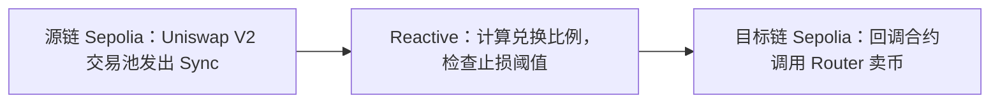

# 用例拆解卡：Uniswap V2 自动止损单

选择 Reactive 生态中的 Uniswap V2 Stop Order 案例：用户预先设定止损价，当交易池中的兑换比例跌到阈值时，自动尝试卖出代币。

## 1. 监听哪条链、哪个合约的什么事件？

监听 **Ethereum Sepolia** 上 Uniswap V2 交易对合约（演示使用 `0x1DD11fD3690979f2602E42e7bBF68A19040E2e25`）发出的 `Sync(uint112 reserve0, uint112 reserve1)` 事件。该事件报告池中两种代币的最新储备量。

## 2. 满足什么条件时触发？

Reactive 合约根据 `reserve0` 和 `reserve1` 计算用户要卖出的代币相对另一种代币的兑换比例。如果比例低于或等于用户设定的止损阈值，且该订单尚未触发，就请求执行回调；否则继续等待后续事件。

## 3. 在哪条链做什么动作？

演示中的回调合约部署在 **Ethereum Sepolia**。它收到请求后再次检查兑换比例，从用户处取得事先授权的代币，通过 Uniswap V2 Router 卖出，将换得的代币交还用户，并发出 `Stop` 事件确认完成。

## 4. 不用 Reactive 怎么做？它简化了什么，代价是什么？

不用 Reactive，需要自己运行持续在线的机器人，监听交易池事件、计算兑换比例、判断止损条件，并发送卖币交易。Reactive 让这些监听和条件判断由合约与网络执行，适合无法修改 Uniswap 交易池合约的场景。

代价是用户需事先授权代币，并为 Reactive 执行及目标链回调准备费用；事件出现到交易执行之间，价格可能继续变化，回调也可能失败。因此止损触发不等于保证按设定价格成交。
