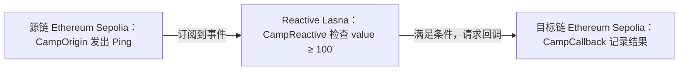

# 用例拆解卡：达到阈值的事件自动触发回调

我选用学习营 starter 的 `Ping → react() → onEvent()` 示例。源链和目标链都用 Ethereum Sepolia，Reactive 合约在 Lasna 上负责判断条件。

## 1. 监听什么？

监听 **Ethereum Sepolia** 上 `CampOrigin` 合约（`0x62508085Dd4F9Ff39dC675A6847A6fe66996414D`）发出的 `Ping(address indexed who, uint256 value)` 事件。

## 2. 什么条件触发？

Lasna 上的 `CampReactive` 收到匹配的 `Ping` 后读取 `value`。当 `value ≥ 100`、剩余处理次数大于 0、目标合约地址已设置时，请求回调；不满足时正常结束，不请求回调。

## 3. 在哪里做什么？

回调发往 **Ethereum Sepolia** 上的 `CampCallback` 合约（`0x17a8240562a42b904e94edf458fA710E8284B912`）。它的 `onEvent()` 记录这次事件的数值和来源交易哈希，增加处理次数，并发出 `Handled` 事件。这是一个“事件满足条件后自动登记结果”的最小示例。

## 4. 不用 Reactive 会怎样？简单在哪里，代价是什么？

在这个源链和目标链都是 Sepolia 的演示里，如果我能修改 `CampOrigin`，也可以直接在 `ping()` 中调用目标合约；此时 Reactive 并非必需。如果源合约不能修改，我就需要运行一个持续在线的机器人：监听日志、判断 `value`，再发送目标交易，并处理断线、重复事件和失败重试。

用 Reactive，可以把“监听哪种事件、何时触发、回调到哪里”写进合约，由网络按订阅执行。它更适合不能修改源合约，或者目标动作要去另一条链的情况。代价是要部署并维护相关合约，为 Lasna 上的 `react()` 和目标链回调分别准备费用；即使执行失败也可能收费，还要检查资金、欠费和回调结果。
