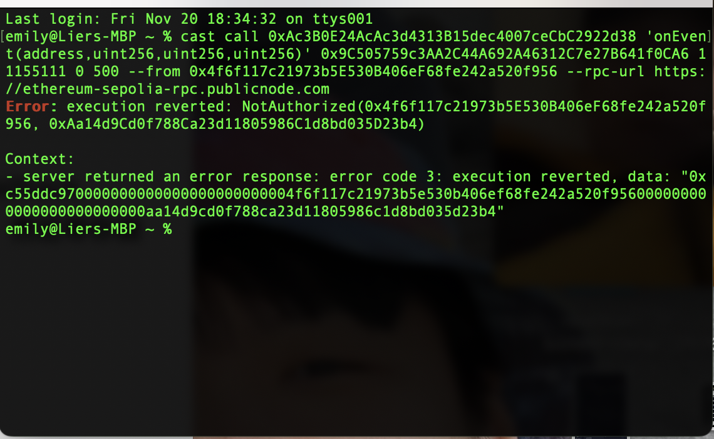

# 跨链回调三步走

链路：Ethereum Sepolia（源链）→ Reactive Lasna → Ethereum Sepolia（目标链）。两端均为测试网。

## 部署合约

| 角色 | 链 | 合约地址 |
| --- | --- | --- |
| 事件来源 `CampOrigin` | Ethereum Sepolia | [`0xf7A9…AFf7f`](https://sepolia.etherscan.io/address/0xf7A9a02b7f184be85D2B8a35F0Fe2de93d7AFf7f) |
| 事件监听与回调请求 `CampReactive` | Reactive Lasna | [`0x9C50…f0CA6`](https://lasna.reactscan.net/address/0x9C505759c3AA2C44A692A46312C7e27B641f0CA6) |
| 回调接收 `CampCallback` | Ethereum Sepolia | [`0xAc3B…22d38`](https://sepolia.etherscan.io/address/0xAc3B0E24AcAc3d4313B15dec4007ceCbC2922d38) |

## 三笔成功交易

| 顺序 | 链 | 结果 | 交易链接 |
| --- | --- | --- | --- |
| 1 | Ethereum Sepolia | `CampOrigin` 发出 `Ping` 事件，`value = 500` | [源链事件交易](https://sepolia.etherscan.io/tx/0x09ea9422e8c28c8c8f65d013ab88604f04da641603086d42ca2f777530db9ede) |
| 2 | Reactive Lasna | `CampReactive.react()` 记录事件并请求回调 | [`react()` 交易](https://lasna.reactscan.net/tx/0xb47783a98dcd0bdeec3bd43f226f5cc70047d25db9fb931c4d2a04feefcd3ebc) |
| 3 | Ethereum Sepolia | `CampCallback.onEvent()` 执行，`count = 1` | [目标链回调交易](https://sepolia.etherscan.io/tx/0xf50fb146a41b97ebbe92f6ef6d378e5e5e70c13780dd5083d8dafff1fec1133e) |

监听条件：只监听上述 `CampOrigin` 的 `Ping` 事件；事件数值达到阈值 `100` 时请求回调。本次以 `500` 触发。目标链 `Handled` 事件记录的源交易哈希与第 1 笔交易一致。

## 失败实验：钱包直接调用 Callback

我先从 Remix 用钱包尝试直接调用 `CampCallback.onEvent()`；MetaMask [提示交易可能失败](images/d4-wallet-direct-call-warning.png)，未签名发送。随后使用 `cast call`，以同一钱包地址 `0x4f6f117c21973b5E530B406eF68fe242a520f956` 作为调用者模拟该调用，得到明确的 `NotAuthorized` 错误。合约只允许 Sepolia Callback Proxy `0xAa14d9Cd0f788Ca23d11805986C1d8bd035D23b4` 直接调用。模拟是只读操作，因此没有失败交易哈希，也没有消耗 gas。

